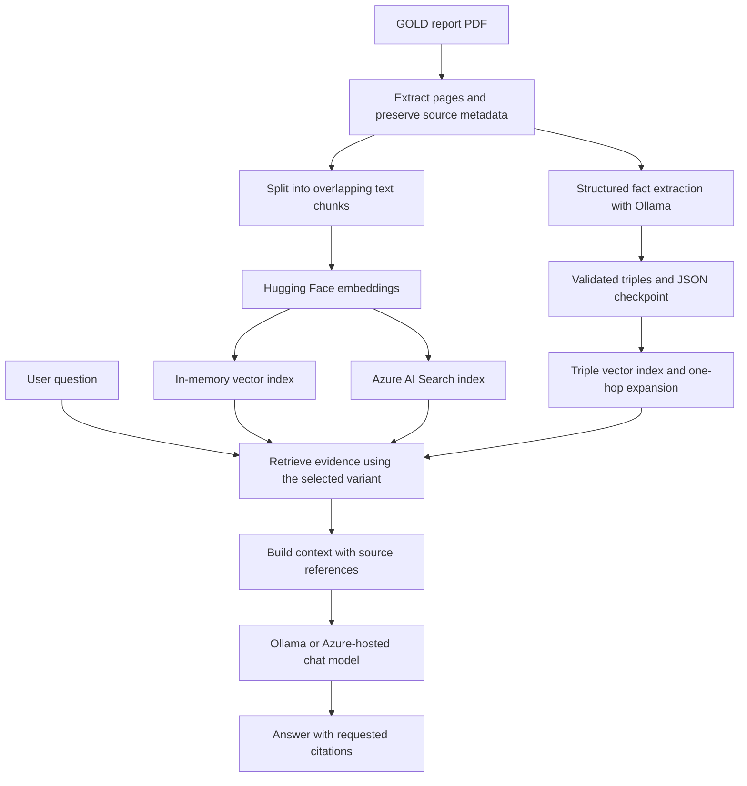
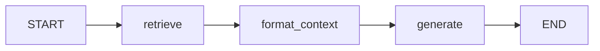

# RAG Pipelines for GOLD COPD Guidelines

A hands-on Python project exploring retrieval-augmented generation (RAG): from a local PDF question-answering pipeline to traced workflows, graph-enhanced retrieval, Azure hybrid search, and an API packaged with Docker.

I built these implementations to learn how to prepare documents, retrieve supporting evidence, generate grounded answers, inspect execution traces, and expose a RAG pipeline as a service. The shared use case is question answering over the GOLD 2025 COPD report.

**Technologies:** Python · LangChain · LangGraph · Hugging Face · Ollama · Langfuse · Azure AI Search · Azure-hosted chat models · FastAPI · Docker · PyVis

This is a learning and portfolio project. It uses medical guideline text as a document corpus; it has not been clinically validated.

## Contents

- [Pipeline overview](#pipeline-overview)
- [1. Local vector RAG](#1-local-vector-rag)
- [2. RAG with Langfuse observability](#2-rag-with-langfuse-observability)
- [3. RAG orchestrated with LangGraph](#3-rag-orchestrated-with-langgraph)
- [4. Knowledge graph-enhanced RAG](#4-knowledge-graph-enhanced-rag)
- [5. Azure hybrid-search RAG](#5-azure-hybrid-search-rag)
- [Serving the Azure pipeline with FastAPI and Docker](#serving-the-azure-pipeline-with-fastapi-and-docker)
- [Skills demonstrated](#skills-demonstrated)
- [Getting started](#getting-started)
- [Evaluation and testing](#evaluation-and-testing)
- [Repository guide](#repository-guide)
- [Current scope and limitations](#current-scope-and-limitations)

## Pipeline overview

Each variant is a separate script. Together, they show the progression from basic retrieval and generation to orchestration, observability, structured evidence, and cloud integration.

| Implementation | Entry point | Retrieval | Generation | Main learning focus |
| --- | --- | --- | --- | --- |
| Local vector RAG | [main.py](main.py) | In-memory vector similarity, top 4 chunks | Ollama `llama3.2:3b` | End-to-end RAG fundamentals |
| Traced RAG | [RAG_LangFuse.py](RAG_LangFuse.py) | In-memory vector similarity, top 4 chunks | Ollama `llama3.2:3b` | Langfuse callbacks and trace collection |
| LangGraph RAG | [RAG_LangGraph.py](RAG_LangGraph.py) | In-memory vector similarity, top 4 chunks | Ollama `llama3.2:3b` | Typed state and explicit workflow stages |
| Graph-enhanced RAG | [RAG_LangFuse_KG.py](RAG_LangFuse_KG.py) | Passage similarity + triple similarity + bounded one-hop expansion | Ollama `llama3.2:3b` by default | Structured extraction, provenance, and graph evidence |
| Azure hybrid RAG | [RAG_Azure_ingest](RAG_Azure_ingest), [RAG_Azure_quesry](RAG_Azure_quesry) | Azure AI Search hybrid retrieval, top 3 chunks at query time | Configured Azure-hosted chat deployment | Persistent cloud indexing and hybrid search |

The Azure pipeline is also exposed through [app.py](app.py), with a [Dockerfile](Dockerfile) for container execution.

All variants use normalized `sentence-transformers/all-mpnet-base-v2` embeddings. Local variants rebuild their passage indexes in memory; the Azure variant separates ingestion from querying an existing index.



The graph branch belongs to the graph-enhanced variant. LangGraph controls workflow execution in its own variant; Langfuse records instrumented calls in the traced and LangGraph variants and optionally in the graph-enhanced variant.

## 1. Local vector RAG

**Implementation:** [main.py](main.py)

This baseline implements the complete document-to-answer flow:

1. Extract PDF text page by page with `pypdf`, retaining the source filename and page index.
2. Split pages into 1,000-character chunks with 200-character overlap.
3. Embed the chunks and store them in LangChain's `InMemoryVectorStore`.
4. Retrieve the four most similar chunks for a question.
5. Format evidence with source and page labels, then generate an answer with Ollama.

The prompt requests answers grounded in the supplied context, citations in `[Page X]` format, and abstention when evidence is insufficient. The script also explores similarity scores and retrieval by a precomputed query vector.

**Skills practiced:** PDF ingestion, metadata preservation, chunking, embeddings, vector search, prompt construction, and source-grounded generation.

## 2. RAG with Langfuse observability

**Implementation:** [RAG_LangFuse.py](RAG_LangFuse.py)

This variant adds Langfuse callbacks to the retriever and model calls. It checks Langfuse authentication and flushes pending trace events before exiting. Passage splitting uses 500-character chunks with 200-character overlap.

**Skills practiced:** Instrumenting an LLM application, configuring tracing credentials, inspecting retrieval and generation runs, and comparing execution behavior across experiments. The script collects traces; it does not implement a scored monitoring dashboard or publish benchmark results.

## 3. RAG orchestrated with LangGraph

**Implementation:** [RAG_LangGraph.py](RAG_LangGraph.py)

This variant expresses retrieval, context formatting, and generation as separate nodes in a compiled `StateGraph`.



The typed `RAGState` carries `question`, `documents`, `context`, and `answer`. Callback configuration flows through the graph, and run metadata records chunk settings, retrieval count, and model names.

**Skills practiced:** Typed workflow state, node-based orchestration, separation of pipeline stages, callback propagation, and experiment metadata. The implemented graph is a linear workflow; it has no agent routing or iterative retrieval loop.

## 4. Knowledge graph-enhanced RAG

**Implementation:** [RAG_LangFuse_KG.py](RAG_LangFuse_KG.py)  
**Detailed guide:** [README-knowledge-graph.md](README-knowledge-graph.md)

This variant combines original document passages with structured facts extracted from the same PDF.

**Extraction and persistence**

- Use 1,800-character extraction chunks with 200-character overlap.
- Ask Ollama for JSON constrained by a predefined entity and relationship schema.
- Validate required fields and labels, and require each supporting quote to appear in its source chunk after case and whitespace normalization.
- Assign source and page provenance from the document loader.
- Checkpoint each processed chunk, retry invalid output with validation feedback, and record unresolved failures for a later run.
- Merge case and whitespace variants and deduplicate facts while preserving distinct evidence.

**Retrieval and generation**

- Build separate in-memory vector indexes for passages and extracted triples.
- Retrieve four passages by default, using 500-character passage chunks with 200-character overlap.
- Retrieve semantically similar graph facts and expand through shared entity names by one hop, with a default cap of twelve facts.
- Supply both passages and graph evidence to the answer model, requesting page citations and giving original evidence precedence.

**Visualization:** [visualize_knowledge_graph.py](visualize_knowledge_graph.py) produces an interactive PyVis HTML graph with entity colors, relationship labels, evidence tooltips, and filtering controls through CLI options.

**Skills practiced:** Structured LLM output, schema validation, evidence checks, entity normalization, graph traversal, resumable extraction, cache invalidation, and combining text with structured retrieval.

This implementation stores the graph in JSON and retrieves embedded facts in memory. Evidence quote validation checks source grounding; it does not prove that the model interpreted a relationship correctly.

## 5. Azure hybrid-search RAG

**Implementation:** [RAG_Azure_ingest](RAG_Azure_ingest) and [RAG_Azure_quesry](RAG_Azure_quesry)

The cloud variant separates indexing from question answering:

| Stage | Implemented behavior |
| --- | --- |
| Ingestion | Load PDF pages, split into 500-character chunks with 200-character overlap, embed locally, and upload documents to Azure AI Search. |
| Retrieval check | Run a similarity-search query after ingestion. |
| Question answering | Use hybrid retrieval to combine keyword and vector search over the Azure index, retrieving three chunks. |
| Generation | Call a configured Azure-hosted deployment through `ChatOpenAI` using an environment-supplied base URL and API key. |
| Evidence output | Request numbered citations such as `[1]`, print their source/page mapping, and print model token-usage metadata. |

**Skills practiced:** Cloud vector indexing, separate ingestion/query workflows, hybrid retrieval, environment-based configuration, hosted model integration, and citation mapping.

The existing query filename is `RAG_Azure_quesry` and both Azure scripts have no `.py` extension. Run them using their exact names with Python.

## Serving the Azure pipeline with FastAPI and Docker

**Implementation:** [app.py](app.py) and [Dockerfile](Dockerfile)

The API exposes the Azure hybrid RAG pipeline through:

| Endpoint | Purpose |
| --- | --- |
| `GET /health` | Return a basic application status response. |
| `POST /ask` | Accept a question and return an answer plus source filenames, citation numbers, and PDF page numbers. |
| `GET /docs` | Explore FastAPI's generated interactive API documentation. |

The application initializes its embedding model, vector store, retriever, and chat client during startup. Pydantic models validate question length and define response structure. The Docker image uses Python 3.11, CPU-only PyTorch, and an embedding model downloaded during the build.

**Skills practiced:** REST API design, request/response validation, application lifecycle management, model initialization, and container packaging.

## Skills demonstrated

| Skill area | Evidence in this repository |
| --- | --- |
| Document preparation | Page-based PDF extraction, overlapping chunks, and source metadata across all ingestion implementations. |
| Semantic retrieval | Normalized sentence-transformer embeddings, similarity search, and top-k retrieval. |
| Grounded prompting | Context-only instructions, requested citations, and insufficient-evidence responses. |
| LLM integration | Local generation and extraction through Ollama; Azure-hosted generation through `ChatOpenAI`. |
| Observability | Langfuse callbacks around retriever/model calls and LangGraph run metadata. |
| Workflow orchestration | Typed state and separate retrieval, context, and generation nodes in LangGraph. |
| Knowledge graphs | Typed triples, evidence provenance, deduplication, one-hop expansion, and PyVis exploration. |
| Extraction reliability | Validation feedback, retries, atomic JSON writes, resumable checkpoints, and signature-based cache reuse. |
| Cloud integration | Azure AI Search ingestion and hybrid retrieval with an independently configured chat deployment. |
| Backend development | FastAPI endpoints, Pydantic schemas, and startup initialization. |
| Deployment preparation | Docker packaging with CPU embeddings and runtime environment configuration. |
| Evaluation and testing | Retrieval hit checks, keyword coverage, abstention matching, and mocked graph pipeline tests. |

## Getting started

Use Python 3.11 to match the Docker image. Run commands from the repository root. You must supply the source PDF locally; document PDFs and generated graph artifacts are excluded from Git.

The scripts expect this filename by default:

```text
GOLD-2025-Report-v1.0-15Nov2024_WMV.pdf
```

The pocket guide is not loaded by the current implementations. The graph-enhanced CLI can use a different document through `--pdf`.

For the local baseline, install Ollama separately, start its service, then run:

```bash
python -m venv .venv
source .venv/bin/activate
python -m pip install -r requirements-kg.txt langgraph
ollama pull llama3.2:3b
python main.py
```

The baseline, traced, LangGraph, and Azure query scripts contain example questions in their source. The graph-enhanced implementation accepts a question directly:

```bash
python RAG_LangFuse_KG.py --question "What is FEV?" --no-langfuse
```

Full-document graph extraction can take substantial time. For a limited extraction trial, use a separate cache:

```bash
python RAG_LangFuse_KG.py --kg-max-chunks 10 --kg-cache knowledge_graph_trial.json --no-langfuse
```

See [docs/setup.md](docs/setup.md) for Langfuse and Azure configuration, API requests, Docker commands, and troubleshooting. Placeholder configuration is provided in [.env.example](.env.example) and [langfuse_apikey.env.example](langfuse_apikey.env.example).

## Evaluation and testing

[evaluation.py](evaluation.py) implements three lightweight checks:

| Check | What it measures |
| --- | --- |
| `evaluate_retrieval` | Whether at least one retrieved PDF page matches an expected page (`hit_at_k`). |
| `keyword_coverage` | The fraction of expected keywords found in an answer using case-insensitive substring matching. |
| `evaluate_abstention` | Whether the answer contains the configured abstention phrase when abstention is expected. |

The example evaluation data contains three questions. It is a starting point for learning evaluation, not a benchmark. In `main.py`, the generated answer and evaluated retrieval item currently concern different questions; in the Langfuse and LangGraph scripts, evaluation code follows `exit()` and does not execute. No comparative accuracy, latency, or cost results are claimed.

Run the existing offline graph tests without cloud credentials, Ollama, or model downloads:

```bash
python -m unittest test_knowledge_graph.py
```

These tests cover provenance, invalid facts, checkpoint reuse and invalidation, validation retries, partial failures, bounded graph expansion, and passage-plus-graph prompt construction. [test_Azure_chatmodel_connection.py](test_Azure_chatmodel_connection.py) is a live connectivity script requiring Azure credentials and service access.

## Repository guide

```text
.
├── README.md                             # Project overview and skills
├── README-knowledge-graph.md              # Graph pipeline details
├── docs/
│   ├── setup.md                          # Configuration and run instructions
│   └── github-description.md             # GitHub About text and portfolio summary
├── main.py                               # Local vector RAG baseline
├── RAG_LangFuse.py                        # Local RAG with tracing
├── RAG_LangGraph.py                       # StateGraph RAG workflow
├── RAG_LangFuse_KG.py                     # Graph-enhanced RAG CLI
├── visualize_knowledge_graph.py          # Interactive graph export
├── RAG_Azure_ingest                       # Azure ingestion script
├── RAG_Azure_quesry                       # Azure hybrid query script
├── app.py                                # Azure RAG FastAPI service
├── evaluation.py                         # Lightweight evaluation helpers
├── test_knowledge_graph.py               # Offline graph tests
├── test_Azure_chatmodel_connection.py     # Live model connectivity check
├── requirements.txt                      # Azure API dependencies
├── requirements-kg.txt                   # Adds local RAG and graph dependencies
├── Dockerfile                            # Azure API container
├── .dockerignore                         # Build-context exclusions
├── .gitignore                            # Credentials and local artifacts excluded
├── .env.example                          # Azure configuration placeholders
└── langfuse_apikey.env.example            # Langfuse configuration placeholders
```

## Current scope and limitations

- These are standalone learning implementations. Several scripts execute ingestion and inference at import time, and local passage indexes are rebuilt on each run.
- Chunk sizes differ between variants, so their outputs are not a controlled comparison of retrieval methods alone.
- The document loader extracts text; it does not implement OCR or specialized table/figure extraction. PDF page positions can differ from printed page labels.
- The knowledge graph uses a predefined vocabulary and case/whitespace matching. It does not perform medical synonym resolution or persistent graph-database queries.
- Prompt instructions request grounding and abstention; the application does not independently verify generated citations or factual correctness.
- The API is a service prototype with no implemented authentication, rate limiting, or conversation memory. `/health` does not probe Azure dependencies.
- Dependencies are not fully pinned, and cloud resources must be configured separately. This repository contains no infrastructure provisioning or evidence of a hosted deployment.

For a concise GitHub About description and a portfolio-ready summary, see [docs/github-description.md](docs/github-description.md).
